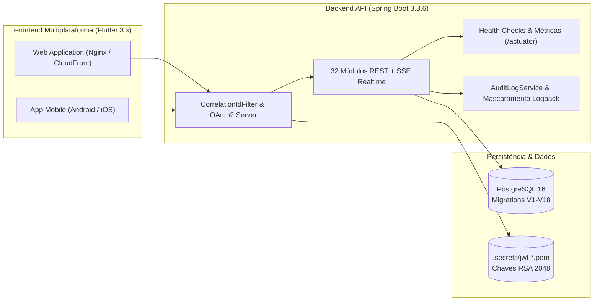

# Âncora Gestão Condominial 🏢⚓

[](https://openjdk.org/)
[](https://spring.io/projects/spring-boot)
[](https://flutter.dev/)
[](https://www.postgresql.org/)
[](https://flywaydb.org/)
[](https://www.docker.com/)
[]()

**Âncora Gestão Condominial** é uma plataforma corporativa completa para administração inteligente e convivência em condomínios residenciais e comerciais. O sistema integra síndicos profissionais, administradoras, porteiros e moradores através de uma arquitetura modular, resiliente, segura e preparada para ambientes de produção.

---

## 🏛️ Visão Geral da Arquitetura

O ecossistema é composto por um backend em **Spring Boot 3.3.6** estruturado como Monólito Modular (*Clean Architecture* e *Domain-Driven Design*), persistência em **PostgreSQL 16** com migrations imutáveis via **Flyway**, e interface multiplataforma em **Flutter 3.x** com design system corporativo SaaS.



---

## ✨ Principais Funcionalidades

- 🔐 **Autenticação Híbrida & RBAC:** Login tradicional via OAuth2 Password Grant (RFC 6749) e identidade federada via Google Identity Services (Google Sign-In), com 4 perfis de acesso (`ROLE_ADMIN`, `ROLE_MANAGER`, `ROLE_CONCIERGE`, `ROLE_RESIDENT`).
- 📦 **Portaria Inteligente & Smart Lockers:** Registro de encomendas, notificações em tempo real, histórico de retiradas e armários inteligentes com código PIN de autoatendimento.
- 📅 **Reservas Concorrentes com Trava Pessimista:** Agendamento de churrasqueiras e salões de festa blindado contra reservas duplicadas (`PESSIMISTIC_WRITE`) e fila de espera automática.
- 💰 **Financeiro & Boletos Registrados:** Gestão de despesas com rateio, extrato de inadimplência e emissão simulada de boletos bancários com código de barras, linha digitável e QR Code Pix.
- 🗳️ **Assembleias Híbridas & Votação:** Convocação, pautas deliberativas, quórum calculado por fração ideal e votação secreta ou aberta.
- 🛠️ **Ordens de Serviço & Manutenção:** Acompanhamento de vistorias periódicas, manutenções preventivas e corretivas com registro de fotos e custos.
- 🚨 **Segurança, Passes QR & SOS Pânico:** Emissão de convites digitais de visitantes para WhatsApp, validação de QR Code na portaria, botão de pânico SOS com transmissão imediata via Server-Sent Events (SSE) e controle de obras sob a norma ABNT NBR 16.280.
- 📊 **Observabilidade Enterprise:** Correlation IDs ponta a ponta (`X-Correlation-ID`), mascaramento automático de senhas/tokens em logs, endpoints `/actuator/health`, `/liveness`, `/readiness`, e métricas operacionais.

---

## 📚 Documentação Técnica Completa

Para aprofundamento técnico em cada dimensão do sistema, consulte os manuais dedicados na pasta `docs/`:

| Documento | Descrição e Conteúdo |
|:---|:---|
| 📐 [**Manual de Arquitetura**](docs/ARCHITECTURE.md) | Visão de componentes C4, responsabilidade das camadas, diagramas de sequência de autenticação e concorrência, decisões arquiteturais (ADRs). |
| 🗄️ [**Manual do Banco de Dados**](docs/DATABASE.md) | Diagrama Entidade-Relacionamento completo (Mermaid), dicionário de dados das 30+ tabelas, constraints, índices e histórico das 18 migrations Flyway. |
| 🔌 [**Referência Completa da API REST**](docs/API_REFERENCE.md) | Catálogo exaustivo dos 32 controllers, parâmetros, DTOs de entrada e saída, requisitos de autenticação, headers de correlation ID e exemplos JSON. |
| 💻 [**Guia do Desenvolvedor**](docs/DEVELOPER_GUIDE.md) | Passo a passo de instalação, variáveis de ambiente, execução local, comandos de teste (`./mvnw test`, `flutter test`), build e convenções de código. |
| 🚀 [**Guia Operacional e DevOps**](docs/OPERATIONS_GUIDE.md) | Procedimentos de deploy, configuração de produção (`application-prod.properties`), Nginx com SSE, rotinas de backup/restore e troubleshooting playbooks. |

---

## ⚡ Inicialização Rápida (Quickstart)

### 1. Subir o Banco de Dados com Docker Compose
```bash
cd backend
docker compose up -d postgres
```
O PostgreSQL estará pronto na porta `5433` com volume persistente.

### 2. Iniciar a API Backend
```bash
cd backend
./mvnw spring-boot:run
```
A API iniciará em `http://localhost:8080`.
- **Swagger UI:** [http://localhost:8080/swagger-ui.html](http://localhost:8080/swagger-ui.html)
- **Health Check:** [http://localhost:8080/actuator/health](http://localhost:8080/actuator/health)

### 3. Iniciar o Frontend Flutter
```bash
cd ../projeto-front  # ou pasta do repositório frontend
flutter pub get
flutter run -d chrome --dart-define=API_BASE_URL=http://localhost:8080
```

---

## 🔑 Credenciais Padrão de Desenvolvimento

No perfil `dev`, a API provisiona automaticamente uma conta administrativa para acesso total aos módulos da plataforma:

- **E-mail:** `admin@ancora.com`
- **Senha:** `ancoraAdmin`
- **Painel:** Acesso irrestrito a condomínios, planos comerciais e métricas do sistema.

---

## 🧪 Suíte de Testes Automatizados

O sistema conta com cobertura abrangente de testes validando integridade referencial, concorrência, segurança RBAC, observabilidade e interface:

```bash
# Backend (122 testes)
cd backend && ./mvnw test

# Frontend (38 testes)
cd projeto-front && flutter test
```
