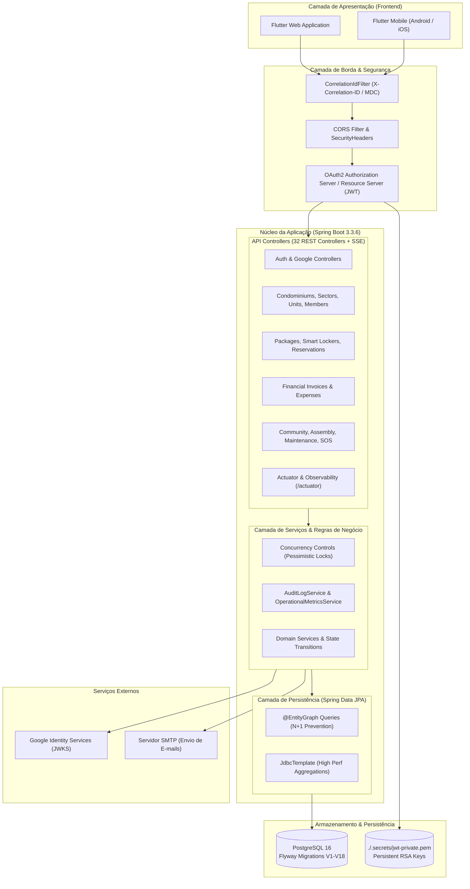
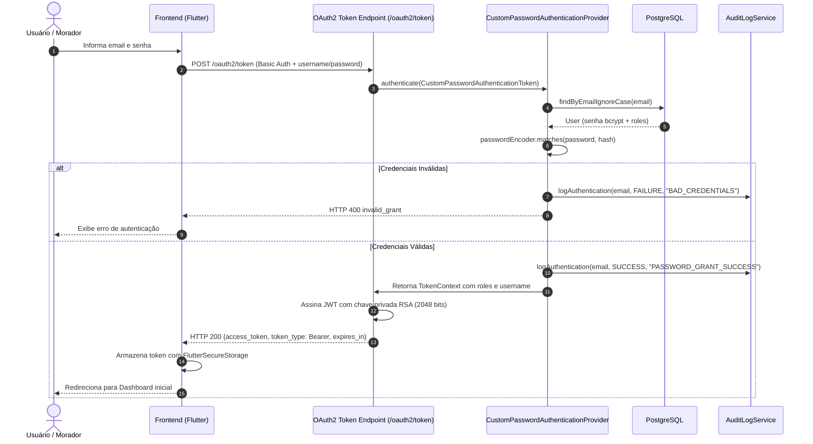
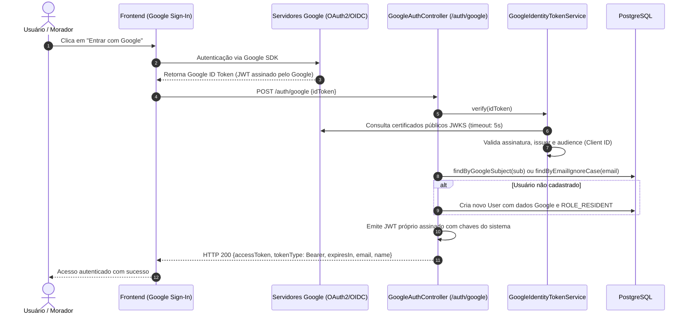
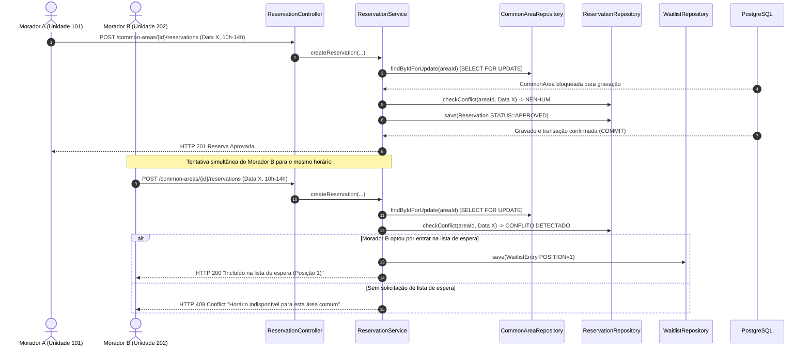
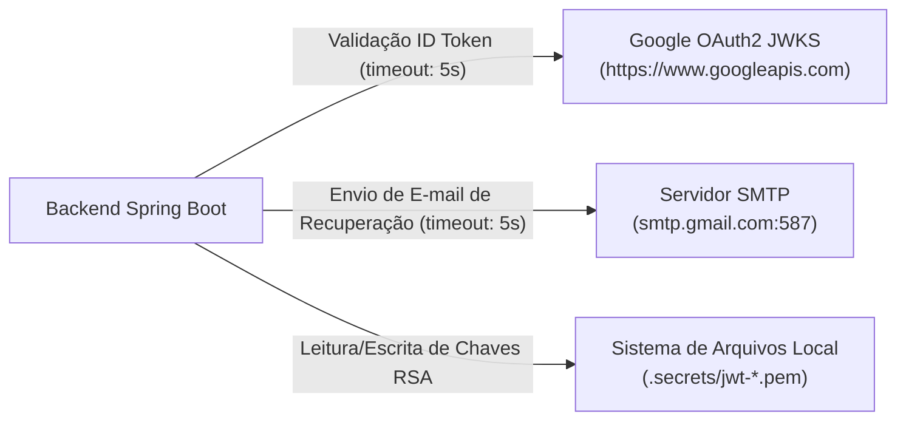

# Documentação Arquitetural do Sistema — Âncora Gestão Condominial

> **Versão da Arquitetura:** 2.0 (Production-Ready)  
> **Data:** Novembro de 2026  
> **Projeto:** Âncora Gestão Condominial (Projeto Final)  
> **Backend:** Java 17 / Spring Boot 3.3.6 (Branch `develop`)  
> **Frontend:** Flutter 3.x / Dart (Branch `main`)  
> **Banco de Dados:** PostgreSQL 16 (com Flyway Migrations V1 a V18)  

---

## 1. Visão Geral da Arquitetura

O sistema **Âncora Gestão Condominial** adota uma arquitetura baseada em **Modular Monolith** no backend e **Feature-Driven Architecture** no frontend Flutter, estruturada sobre os princípios da *Clean Architecture*, *Domain-Driven Design (DDD) pragmático* e padrões corporativos para resiliência e observabilidade em ambiente de produção.

O backend opera como uma API REST stateless acompanhada de streaming Server-Sent Events (SSE), suportando múltiplos condomínios com isolamento de dados por relacionamento (*multi-tenant lógico*) e controle de acesso estrito baseado em papéis (RBAC).

---

## 2. Responsabilidades por Módulo e Camada

A aplicação está decomposta em submódulos coesos localizados sob o pacote raiz `com.cefet_rj.projeto_final`:

| Módulo | Responsabilidade | Principais Entidades e Classes |
|:---|:---|:---|
| **`auth`** | Emissão e validação de tokens JWT, suporte ao OAuth2 Authorization Server (RFC 6749), persistência de chaves RSA em disco, e integração com Google Identity Token. | `AuthorizationServerConfig`, `ResourceServerConfig`, `CustomPasswordAuthenticationProvider`, `GoogleIdentityTokenService`, `PersistentRsaKeyService`. |
| **`users`** | Cadastro de contas globais, perfis de usuários, fotos de perfil em base64/mídia, atualização de senhas e preferências de tema. | `User`, `Role`, `UserRepository`, `UserService`, `UserController`, `UserProfileController`. |
| **`condominiums`** | Estrutura física e organizacional do condomínio: blocos/setores, unidades habitacionais, vagas de garagem, galeria de fotos e quadro de avisos. | `Condominium`, `Sector`, `Unit`, `Resident`, `ParkingSpot`, `KeyRegistry`, `CondominiumController`, `SectorController`, `UnitController`. |
| **`membership`** | Gestão de membros, vínculos de usuários com condomínios, atribuição de perfis locais e aprovação de solicitações por síndicos. | `CondominiumUser`, `MembershipInvitationStatus`, `MembershipService`, `MembershipController`, `MembershipManagementController`. |
| **`billing`** | Catálogo de planos de faturamento SaaS (Basic, Pro, Enterprise) e habilitação dinâmica de módulos por condomínio. | `BillingPlan`, `Feature`, `FeatureCode`, `BillingPlanService`, `BillingPlanController`. |
| **`reservations`** | Agendamento e locação de áreas comuns (churrasqueiras, salões de festas), aprovação pelo síndico, controle concorrente pessimista e fila de espera automática. | `CommonArea`, `Reservation`, `ReservationWaitlist`, `ReservationService`, `ReservationController`. |
| **`packages`** | Gestão completa de encomendas recebidas na portaria, histórico de retiradas por assinatura/código e armários inteligentes (Smart Lockers). | `Package`, `PackageHistory`, `SmartLockerCompartment`, `PackageService`, `PackageController`. |
| **`financial`** | Despesas condominiais com rateio, prestação de contas, emissão de boletos bancários simulados com código de barras, linha digitável e pagamentos. | `FinancialExpense`, `CondoInvoice`, `FinancialService`, `FinancialController`. |
| **`maintenance`** | Gestão de ordens de serviço prediais (preventivas, corretivas e vistorias periódicas) com fotos, prazos e custos. | `MaintenanceOrder`, `MaintenanceService`, `MaintenanceController`. |
| **`assemblies`** | Assembleias virtuais e presenciais, pautas de discussão, sessões de votação e apuração de quórum com voto secreto ou aberto. | `Assembly`, `AssemblyAgendaItem`, `AssemblyVote`, `AssemblyService`, `AssemblyController`. |
| **`community`** | Hub comunitário de convivência: Achados e Perdidos com chat, Alertas SOS/Pânico com notificações prioritárias, Passes de Visitantes QR, Obras NBR 16.280, Enquetes, Classificados e Caronas. | `LostFoundItem`, `PanicAlert`, `VisitorAccess`, `RenovationRequest`, `Poll`, `CondominiumCommunityController`, `DoormanChatController`. |
| **`assistant`** | Assistente virtual inteligente contextualizado para responder dúvidas sobre convenção de condomínio, regras e status de solicitações. | `CondoAssistantService`, `CondoAssistantController`. |
| **`realtime`** | Distribuição de eventos em tempo real para o frontend via Server-Sent Events (SSE) com reconexão automática. | `RealtimeEvent`, `RealtimeService`, `RealtimeController`. |
| **`reports`** | Dashboards analíticos para síndicos e administradores globais, com exportação de dados tabulares em CSV e relatórios em PDF. | `ReportService`, `AdminDashboardController`, `ReportController`. |
| **`observability`** | Filtro de correlação distribuída, sanitização de logs com mascaramento de credenciais, auditoria estruturada e endpoints padrão Actuator. | `CorrelationIdFilter`, `SensitiveDataMaskingConverter`, `AuditLogService`, `OperationalMetricsService`, `ActuatorObservabilityController`. |

---

## 3. Comunicação entre Frontend e Backend

A integração entre a aplicação Flutter (`projeto-front`) e o backend Spring Boot (`projeto-final`) é orientada a contratos REST com suporte a streaming unidirecional em tempo real:

1. **Protocolo Base:** HTTP/1.1 sobre TLS (HTTPS em produção).
2. **Formato de Carga Útil:** JSON (`application/json; charset=UTF-8`).
3. **Rastreabilidade de Requisições:** Cada requisição emitida pelo [`HttpClientWrapper`](file:///home/antigravity/samuelbueno123/projeto-front/lib/core/http/http_client_wrapper.dart) inclui o cabeçalho `X-Correlation-ID: req-<hex>-<hex>`. O backend intercepta, vincula ao MDC e reflete o mesmo cabeçalho no response.
4. **Resiliência a Falhas Transitórias:** O `HttpClientWrapper` implementa retentativa automática com backoff linear para requisições idempotentes (`GET`, `PUT`, `DELETE`) sob códigos HTTP 503 e 504.
5. **Streaming Server-Sent Events (SSE):** Conexão persistente em `GET /realtime/stream?condominiumId={id}` utilizando `text/event-stream`. Eventos com formato `{"type": "PACKAGE_RECEIVED|EMERGENCY_ALERT", "payload": {...}}` são consumidos via Stream no Flutter sem polling repetitivo.

---

## 4. Fluxos de Autenticação e Autorização

O sistema suporta autenticação híbrida: credenciais locais (OAuth2 Password Grant) e identidade federada via Google OAuth2/OIDC.

### 4.1. Fluxo OAuth2 Password Grant (Credenciais Locais)

### 4.2. Fluxo Federado Google Identity Token

### 4.3. Modelo de Autorização RBAC (Role-Based Access Control)
As permissões são controladas por anotações `@PreAuthorize("hasAuthority('ROLE_...')")`:
- `ROLE_ADMIN`: Administrador global da plataforma SaaS (gestão de planos, métricas globais de `/actuator`, condomínios).
- `ROLE_MANAGER`: Síndico ou administradora predial (aprovação de membros, finanças, assembleias, avisos, vistorias).
- `ROLE_CONCIERGE`: Porteiro ou operador de guarita (registro de encomendas, armários inteligentes, liberação de visitantes, chat).
- `ROLE_RESIDENT`: Morador condômino ou inquilino (reservas, notificações, pânico SOS, votação em assembleias, boletos).

---

## 5. Fluxos Críticos de Negócio

### 5.1. Reserva Concorrente com Trava Pessimista e Fila de Espera Automática

### 5.2. Alerta de Emergência SOS e Notificação Prioritária
1. Morador aciona o botão **SOS Pânico** no aplicativo Flutter (opções: Incêndio, Médico, Segurança, Outros).
2. O aplicativo dispara `POST /condominiums/{id}/emergency/panic` com as coordenadas, unidade e descrição.
3. O `CondominiumCommunityService` grava o alerta na tabela `tb_panic_alert`.
4. O `AuditLogService` registra o evento crítico com prioridade `WARN` (`AUDIT_EMERGENCY`).
5. O `RealtimeService` despacha imediatamente um evento SSE com tipo `EMERGENCY_ALERT` para todas as telas ativas da portaria (`DoormanPage`) e síndicos logados, emitindo aviso sonoro e visual imediato.

---

## 6. Principais Decisões Arquiteturais (ADRs)

### ADR-001: Persistência de Chaves Criptográficas RSA em Disco
- **Contexto:** Em reinicializações do servidor, a geração de pares de chaves em memória invalidava todos os tokens JWT emitidos anteriormente, deslogando forçadamente todos os usuários.
- **Decisão:** Implementação de `PersistentRsaKeyService`, que verifica a existência de arquivos `.secrets/jwt-private.pem` e `jwt-public.pem`. Se inexistentes, gera um novo par RSA 2048 bits e grava no disco com permissões restritas.
- **Consequência:** Sessões mantêm-se válidas e estáveis entre deploys e reinicializações de contêineres.

### ADR-002: Controle de Concorrência Pessimista (`PESSIMISTIC_WRITE`) em Reservas
- **Contexto:** Sob alta concorrência (ex.: liberação de datas festivas como Réveillon e Natal), requisições paralelas causavam *double booking* na mesma área comum.
- **Decisão:** Aplicar `@Lock(LockModeType.PESSIMISTIC_WRITE)` em consultas críticas de áreas comuns e reservas, serializando as operações no nível de linha do PostgreSQL.
- **Consequência:** Eliminação total de reservas duplicadas com integridade garantida pelo banco de dados.

### ADR-003: Mascaramento Centralizado de Dados Sensíveis no Logback
- **Contexto:** Logs de depuração e auditoria poderiam acidentalmente registrar senhas, tokens Bearer ou cartões de crédito.
- **Decisão:** Criação de `SensitiveDataMaskingConverter` no pipeline de conversão do Logback, substituindo padrões regex sensíveis por `***MASKED***` antes da saída no console ou arquivo.
- **Consequência:** Conformidade estrita com normas de privacidade (LGPD/GDPR) e segurança de dados em produção.

### ADR-004: Versionamento Imutável de Esquema via Flyway
- **Contexto:** A evolução de um modelo relacional corporativo não deve depender de mecanismos automáticos e imprevisíveis como `hibernate.ddl-auto=update`.
- **Decisão:** Uso obrigatório do Flyway com perfil de produção configurado para `validate` (`spring.jpa.hibernate.ddl-auto=validate`).
- **Consequência:** Rastreabilidade completa, reprodutibilidade em todos os ambientes e integridade absoluta dos dados existentes.

---

## 7. Dependências Externas e Limites de Integração

- **Resiliência de Rede:** Todas as comunicações síncronas para o exterior possuem `connectTimeout` e `readTimeout` definidos em **5000 milissegundos**, evitando o enfileiramento infinito de requisições no servidor.
