# Documentação do Banco de Dados — Modelo Relacional e Persistência

> **Sistema:** Âncora Gestão Condominial  
> **Banco de Dados:** PostgreSQL 16 (H2 em memória para testes)  
> **Gerenciador de Migrations:** Flyway (V1 a V18)  
> **Estratégia DDL Produção:** `spring.jpa.hibernate.ddl-auto=validate`  

---

## 1. Diagrama Entidade-Relacionamento (ERD)

```mermaid
erDiagram
    TB_USER ||--o{ TB_USER_ROLE : possui
    TB_ROLE ||--o{ TB_USER_ROLE : atribuida_a
    TB_USER ||--o{ TB_CONDOMINIUM_USER : membro_de
    TB_CONDOMINIUM ||--o{ TB_CONDOMINIUM_USER : possui_membros

    TB_BILLING_PLAN ||--o{ TB_CONDOMINIUM : assina
    TB_BILLING_PLAN ||--o{ TB_PLAN_FEATURE : contem
    TB_FEATURE ||--o{ TB_PLAN_FEATURE : vinculada_a

    TB_CONDOMINIUM ||--o{ TB_SECTOR : dividido_em
    TB_SECTOR ||--o{ TB_UNIT : contem
    TB_UNIT ||--o{ TB_RESIDENT : habitada_por
    TB_USER ||--o{ TB_RESIDENT : e_morador

    TB_CONDOMINIUM ||--o{ TB_COMMON_AREA : disponibiliza
    TB_COMMON_AREA ||--o{ TB_RESERVATION : agendada_em
    TB_USER ||--o{ TB_RESERVATION : reserva
    TB_COMMON_AREA ||--o{ TB_RESERVATION_WAITLIST : fila_de
    TB_USER ||--o{ TB_RESERVATION_WAITLIST : aguarda_em

    TB_UNIT ||--o{ TB_PACKAGE : enderecado_a
    TB_PACKAGE ||--o{ TB_PACKAGE_HISTORY : historico
    TB_CONDOMINIUM ||--o{ TB_SMART_LOCKER_COMPARTMENT : possui_armarios
    TB_PACKAGE ||--o| TB_SMART_LOCKER_COMPARTMENT : alocado_em

    TB_CONDOMINIUM ||--o{ TB_FINANCIAL_EXPENSE : registra_despesas
    TB_CONDOMINIUM ||--o{ TB_CONDO_INVOICE : emite_boletos
    TB_UNIT ||--o{ TB_CONDO_INVOICE : cobranca_para

    TB_CONDOMINIUM ||--o{ TB_MAINTENANCE_ORDER : ordens_servico
    TB_CONDOMINIUM ||--o{ TB_ASSEMBLY : realiza_assembleias
    TB_ASSEMBLY ||--o{ TB_ASSEMBLY_AGENDA_ITEM : pautas
    TB_ASSEMBLY_AGENDA_ITEM ||--o{ TB_ASSEMBLY_VOTE : votos

    TB_CONDOMINIUM ||--o{ TB_VISITOR_ACCESS : controle_visitantes
    TB_CONDOMINIUM ||--o{ TB_PANIC_ALERT : alertas_emergencia
    TB_CONDOMINIUM ||--o{ TB_RENOVATION_REQUEST : gestao_obras
    TB_CONDOMINIUM ||--o{ TB_LOST_FOUND_ITEM : achados_perdidos
    TB_LOST_FOUND_ITEM ||--o{ TB_LOST_FOUND_MESSAGE : mensagens_chat
    TB_CONDOMINIUM ||--o{ TB_DOORMAN_MESSAGE : chat_portaria
    TB_CONDOMINIUM ||--o{ TB_POLL : enquetes
    TB_POLL ||--o{ TB_POLL_OPTION : opcoes
    TB_POLL_OPTION ||--o{ TB_POLL_VOTE : votos_enquete
    TB_CONDOMINIUM ||--o{ TB_NOTIFICATION : notificacoes
```

---

## 2. Catálogo de Entidades e Tabelas

### 2.1. Núcleo de Usuários e Segurança

#### `tb_user`
Armazena as contas de usuários autenticáveis no sistema.
- `id` (BIGSERIAL, PK): Identificador único da conta.
- `first_name` (VARCHAR(100), NOT NULL): Primeiro nome do usuário.
- `last_name` (VARCHAR(100)): Sobrenome.
- `email` (VARCHAR(150), NOT NULL, UNIQUE): Endereço de e-mail (índice lower-case para busca case-insensitive).
- `password` (VARCHAR(255), NOT NULL): Hash bcrypt da senha de acesso.
- `google_subject` (VARCHAR(255), UNIQUE): Identificador único emitido pelo Google Identity Services (sub).
- `profile_image` (TEXT): Imagem em base64 ou URL relativa servida via `/media/pictures/`.
- `theme_preference` (VARCHAR(20), DEFAULT 'SYSTEM'): Preferência de tema (`LIGHT`, `DARK`, `SYSTEM`).

#### `tb_role`
Catálogo de perfis de autorização do sistema.
- `id` (BIGSERIAL, PK): Identificador único da permissão.
- `authority` (VARCHAR(50), NOT NULL, UNIQUE): Código da autoridade (`ROLE_ADMIN`, `ROLE_MANAGER`, `ROLE_CONCIERGE`, `ROLE_RESIDENT`).

#### `tb_user_role`
Tabela associativa de relacionamento N:M entre usuários e seus papéis globais.
- `user_id` (BIGINT, FK -> `tb_user.id`, ON DELETE CASCADE): Usuário.
- `role_id` (BIGINT, FK -> `tb_role.id`, ON DELETE CASCADE): Papel atribuído.
- PK: Composta `(user_id, role_id)`.

#### `oauth2_authorization` e `oauth2_registered_client`
Tabelas padrão do framework Spring Security OAuth2 Authorization Server para persistência de clientes, códigos de autorização e sessões de tokens emitidos.

---

### 2.2. Condomínio e Estrutura Física

#### `tb_condominium`
Representa um condomínio residencial ou comercial cadastrado na plataforma.
- `id` (BIGSERIAL, PK): Identificador único do condomínio.
- `name` (VARCHAR(150), NOT NULL): Razão social ou nome de fachada.
- `address` (VARCHAR(255), NOT NULL): Endereço completo.
- `image_url` (VARCHAR(500)): Foto de capa do condomínio.
- `is_active` (BOOLEAN, DEFAULT TRUE): Estado de ativação da assinatura.
- `billing_plan_id` (BIGINT, FK -> `tb_billing_plan.id`): Plano contratado.

#### `tb_condominium_user`
Vínculo de membresia de um usuário a um condomínio específico com status de convite.
- `id` (BIGSERIAL, PK): Identificador único da membresia.
- `condominium_id` (BIGINT, FK -> `tb_condominium.id`, ON DELETE CASCADE, NOT NULL).
- `user_id` (BIGINT, FK -> `tb_user.id`, ON DELETE CASCADE, NOT NULL).
- `role_id` (BIGINT, FK -> `tb_role.id`, ON DELETE CASCADE, NOT NULL).
- `status` (VARCHAR(30), NOT NULL): Estado do vínculo (`PENDING`, `ACCEPTED`, `DECLINED`, `REQUESTED`).
- `created_at` (TIMESTAMP WITHOUT TIME ZONE, NOT NULL).
- `updated_at` (TIMESTAMP WITHOUT TIME ZONE).
- **Constraint de Integridade:** `UK_CONDO_USER_ROLE (condominium_id, user_id, role_id)` — Impede registros duplicados da mesma função no mesmo condomínio.

#### `tb_sector`
Blocos, torres, alas ou vilas de um condomínio.
- `id` (BIGSERIAL, PK): Identificador único do setor.
- `name` (VARCHAR(100), NOT NULL): Ex.: "Torre A", "Bloco 2".
- `structural_type` (VARCHAR(30)): Tipo (`BLOCK`, `TOWER`, `VILLAGE`).
- `image_url` (VARCHAR(500)): Foto de identificação do bloco.
- `condominium_id` (BIGINT, FK -> `tb_condominium.id`, ON DELETE CASCADE, NOT NULL).

#### `tb_unit`
Apartamentos, salas comerciais, casas ou lotes.
- `id` (BIGSERIAL, PK): Identificador da unidade.
- `identifier` (VARCHAR(50), NOT NULL): Número da unidade (ex.: "101", "204B").
- `sector_id` (BIGINT, FK -> `tb_sector.id`, ON DELETE CASCADE, NOT NULL).
- **Constraint de Integridade:** `UK_UNIT_SECTOR_IDENTIFIER (sector_id, identifier)` — Impede números de apartamento duplicados dentro do mesmo bloco.

#### `tb_resident`
Vínculo oficial de moradores (proprietários ou inquilinos) com uma unidade física.
- `id` (BIGSERIAL, PK): Identificador do registro.
- `user_id` (BIGINT, FK -> `tb_user.id`, ON DELETE CASCADE, NOT NULL).
- `unit_id` (BIGINT, FK -> `tb_unit.id`, ON DELETE CASCADE, NOT NULL).
- `is_tenant` (BOOLEAN, DEFAULT FALSE): Flag indicando inquilino vs proprietário.
- **Constraint de Integridade:** `UK_RESIDENT_USER_UNIT (user_id, unit_id)` — Impede morador duplicado na mesma unidade.

#### `tb_parking_spot` e `tb_vehicle`
- `tb_parking_spot`: Vagas de garagem (`code`, `spot_type`, `status`, `condominium_id`, `unit_id`). Constraint: `UNIQUE(condominium_id, code)`.
- `tb_vehicle`: Veículos autorizados com placa, modelo, cor e unidade correspondente.

---

### 2.3. Áreas Comuns e Reservas

#### `tb_common_area`
Espaços de uso comum locáveis por condôminos.
- `id` (BIGSERIAL, PK): Identificador da área.
- `name` (VARCHAR(100), NOT NULL): Ex.: "Churrasqueira 1", "Salão de Festas Principal".
- `capacity` (INTEGER, NOT NULL, CHECK > 0): Lotação máxima permitida.
- `requires_approval` (BOOLEAN, DEFAULT FALSE): Exigência de aprovação manual pelo síndico.
- `price` (NUMERIC(10,2), CHECK >= 0): Taxa de locação.
- `condominium_id` (BIGINT, FK -> `tb_condominium.id`, ON DELETE CASCADE, NOT NULL).

#### `tb_reservation`
Agendamento formal de uma área comum.
- `id` (BIGSERIAL, PK): Identificador da reserva.
- `start_at` (TIMESTAMP, NOT NULL): Horário de início.
- `end_at` (TIMESTAMP, NOT NULL): Horário de término.
- `status` (VARCHAR(30), NOT NULL): `PENDING`, `APPROVED`, `REJECTED`, `CANCELLED`.
- `notes` (TEXT): Observações do solicitante.
- `contact_phone` (VARCHAR(30)): Telefone de emergência.
- `common_area_id` (BIGINT, FK -> `tb_common_area.id`, ON DELETE CASCADE, NOT NULL).
- `reserved_by_id` (BIGINT, FK -> `tb_user.id`, ON DELETE CASCADE, NOT NULL).
- `reviewed_by_id` (BIGINT, FK -> `tb_user.id`): Síndico que aprovou/rejeitou.
- **Regra de Validação:** `CHECK (end_at > start_at)`.

#### `tb_reservation_waitlist`
Fila de espera para áreas comuns concorridas.
- `id` (BIGSERIAL, PK).
- `common_area_id` (BIGINT, FK -> `tb_common_area.id`, ON DELETE CASCADE, NOT NULL).
- `user_id` (BIGINT, FK -> `tb_user.id`, ON DELETE CASCADE, NOT NULL).
- `desired_date` (DATE, NOT NULL).
- `position` (INTEGER, NOT NULL).
- `status` (VARCHAR(30), DEFAULT 'WAITING').

---

### 2.4. Encomendas e Armários Inteligentes (Smart Lockers)

#### `tb_package`
Rastreamento de encomendas e correspondências recebidas na portaria.
- `id` (BIGSERIAL, PK).
- `tracking_code` (VARCHAR(100)): Código dos Correios ou transportadora.
- `description` (VARCHAR(255), NOT NULL): Descrição da embalagem.
- `carrier` (VARCHAR(100)): Transportadora (ex.: "Mercado Livre", "Amazon").
- `status` (VARCHAR(30), NOT NULL): Máquina de estados: `RECEIVED` -> `READY_FOR_PICKUP` -> `DELIVERED`.
- `received_at` (TIMESTAMP, NOT NULL).
- `delivered_at` (TIMESTAMP): Data e hora da entrega ao morador.
- `unit_id` (BIGINT, FK -> `tb_unit.id`, ON DELETE CASCADE, NOT NULL).
- `received_by_id` (BIGINT, FK -> `tb_user.id`): Porteiro que recebeu.
- `delivered_by_id` (BIGINT, FK -> `tb_user.id`): Porteiro que entregou.
- `recipient_resident_id` (BIGINT, FK -> `tb_user.id`): Morador que retirou.

#### `tb_smart_locker_compartment`
Armários inteligentes automáticos para retirada sem intervenção humana.
- `id` (BIGSERIAL, PK).
- `compartment_number` (VARCHAR(20), NOT NULL): Ex.: "Armário 04".
- `locker_size` (VARCHAR(20), NOT NULL): `SMALL`, `MEDIUM`, `LARGE`.
- `status` (VARCHAR(20), NOT NULL): `AVAILABLE`, `OCCUPIED`, `MAINTENANCE`.
- `access_pin` (VARCHAR(10)): PIN de segurança de 4 a 6 dígitos para destravamento.
- `condominium_id` (BIGINT, FK -> `tb_condominium.id`, ON DELETE CASCADE, NOT NULL).
- `current_package_id` (BIGINT, FK -> `tb_package.id`, ON DELETE SET NULL).
- **Constraint:** `UK_LOCKER_CONDO_COMPARTMENT (condominium_id, compartment_number)`.

---

### 2.5. Módulos Financeiros, Manutenção e Assembleias

- **`tb_financial_expense`:** Despesas condominiais categorizadas com vencimento, valor, comprovante e rateio.
- **`tb_condo_invoice`:** Boletos bancários gerados com código de barras, linha digitável, QR Code Pix e status (`PENDING`, `PAID`, `OVERDUE`).
- **`tb_maintenance_order`:** Ordens de serviço para manutenção preventiva, corretiva e vistorias prediais.
- **`tb_assembly` & `tb_assembly_agenda_item` & `tb_assembly_vote`:** Assembleias de deliberação com votos auditados por fração ideal.

---

### 2.6. Comunidade, Portaria e Segurança

- **`tb_visitor_access`:** Passes de visitantes com código alfanumérico, link de compartilhamento WhatsApp e validação de QR Code pela portaria.
- **`tb_panic_alert`:** Alertas SOS com localização, tipo de ocorrência e acompanhamento de resolução.
- **`tb_renovation_request`:** Solicitações de obras segundo a norma ABNT NBR 16.280, com envio de ART/RRT e laudo técnico.
- **`tb_lost_found_item` & `tb_lost_found_message`:** Gestão de itens perdidos e achados com mural de mensagens privativo.
- **`tb_doorman_message`:** Comunicação instantânea de texto entre portaria e apartamentos.
- **`tb_poll`, `tb_poll_option`, `tb_poll_vote`:** Enquetes democráticas com votação única por condômino.

---

## 3. Estratégia de Migrations Flyway

O histórico de evolução da base de dados é mantido de forma contínua e imutável pelo Flyway:

| Migration | Versão | Objetivo e Escopo das Alterações |
|:---|:---|:---|
| `V1` | Initial Schema | Criação das tabelas base de usuários, permissões, condomínios, setores, unidades e áreas comuns. |
| `V2` | Seed Reference Data | Carga de papéis padrão (`ROLE_ADMIN`, `ROLE_MANAGER`, `ROLE_CONCIERGE`, `ROLE_RESIDENT`). |
| `V3` | OAuth2 Authorization | Criação das tabelas padrão do Spring Authorization Server. |
| `V4` | Registered Client | Registro do cliente OAuth2 padrão (`client_id`, escopos de leitura/escrita). |
| `V5` | User Profile Image | Adição de suporte a foto de perfil nos usuários. |
| `V6` | Notifications & Dashboard | Suporte a notificações de sistema e visão gerencial do síndico. |
| `V7` | Membership Invitations | Fluxo de convites formais para novos membros com controle de estado. |
| `V8` | Seed Billing Plans | Carga dos planos comerciais padrão (Basic, Pro, Enterprise). |
| `V9` | Unit Announcements | Avisos direcionados a blocos/unidades específicas e telefone de emergência em reservas. |
| `V10` | Features & Profile Pictures | Catálogo completo de features por plano e aprimoramento de fotos. |
| `V11` | Condo Gallery & Themes | Galeria de fotos institucionais do condomínio, chat e preferências de tema visual. |
| `V12` | Realtime Indexes | Índices estratégicos para suporte a polling/SSE em notificações. |
| `V13` | Financial & Maintenance | Tabelas de despesas financeiras, ordens de serviço e assembleias. |
| `V14` | Condominium Image URL | Campo de imagem de capa para condomínios. |
| `V15` | Sector Image & Hub Tracking | Imagens para blocos e rastreamento de unidades no hub comunitário. |
| `V16` | Commercial Optimizations | Achados e perdidos, mensagens da portaria, enquetes, classificados e caronas. |
| `V17` | Competitive Features | Smart lockers, boletos bancários simulados, SOS emergência, passes QR de visitantes e obras NBR 16.280. |
| `V18` | Persistence Optimizations | Adição de 38 índices em chaves estrangeiras, unique constraints contra duplicações e check constraints de integridade de domínio. |

---

## 4. Otimizações de Performance e Índices

Na migration `V18`, foram consolidados **38 índices relacionais e compostos** para garantir tempos de resposta sub-milissegundo em consultas analíticas e prevenir deadlocks sob concorrência:

1. **Índices de Chave Estrangeira:** Todas as FKs possuem índices B-Tree correspondentes, eliminando *table scans* durante operações de `DELETE CASCADE` ou `JOIN`.
2. **Índices de Busca Case-Insensitive:** `idx_user_email_lower ON tb_user (LOWER(email))` acelera o login instantâneo por e-mail.
3. **Índices Compostos de Consulta Recorrente:**
   - `idx_reservation_area_dates`: `(common_area_id, start_at, end_at)` para checagem imediata de choque de horários.
   - `idx_package_unit_status`: `(unit_id, status)` para visualização de encomendas pendentes pelo morador.
   - `idx_invoice_unit_status`: `(unit_id, status)` para consulta de inadimplência e extrato de boletos.
   - `idx_visitor_code`: `(access_code)` para validação instantânea na portaria.
   - `idx_panic_condo_status`: `(condominium_id, status)` para filtragem imediata de emergências abertas.
