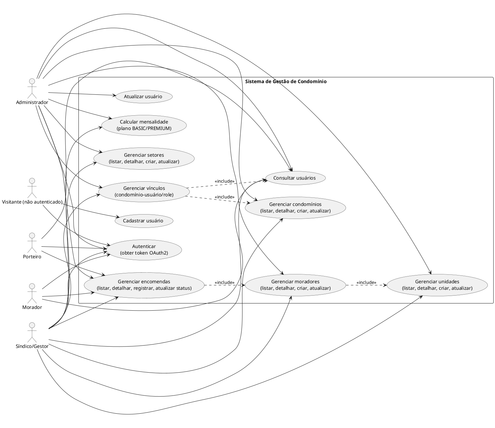

# Diagramas de Caso de Uso — Projeto Final

Este documento consolida o escopo funcional do projeto inteiro com base nos endpoints REST expostos no backend e no uso do frontend para consumo da API.

## 1) Diagrama de Caso de Uso Geral

> Fonte PlantUML: `docs/diagramas-caso-de-uso.puml`

## 2) Mapeamento de escopo considerado

- **Autenticação e autorização**: token OAuth2/JWT e proteção de rotas.
- **Gestão de usuários**: CRUD parcial via `GET/POST/PUT`.
- **Gestão condominial**: condomínios, setores, unidades, moradores e vínculos de papéis.
- **Gestão de encomendas**: cadastro, consulta e atualização de status.
- **Cálculo de cobrança**: cálculo com estratégia por plano (BASIC/PREMIUM).

## 3) Observações

- O frontend atual demonstra consumo de API (exemplo de leitura de usuários) e não limita o escopo funcional do domínio.
- O diagrama representa os **casos de uso do sistema como um todo** (principalmente o backend, que concentra as regras de negócio e endpoints).
