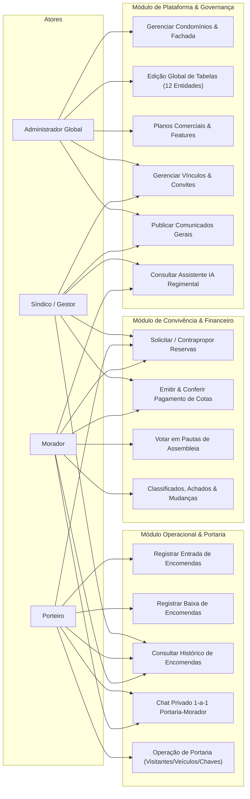
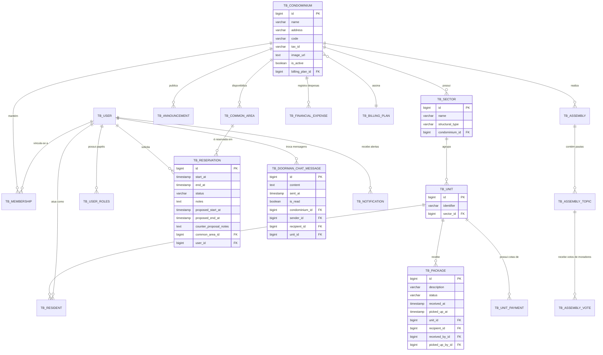
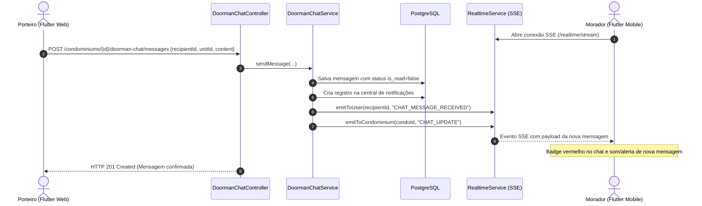
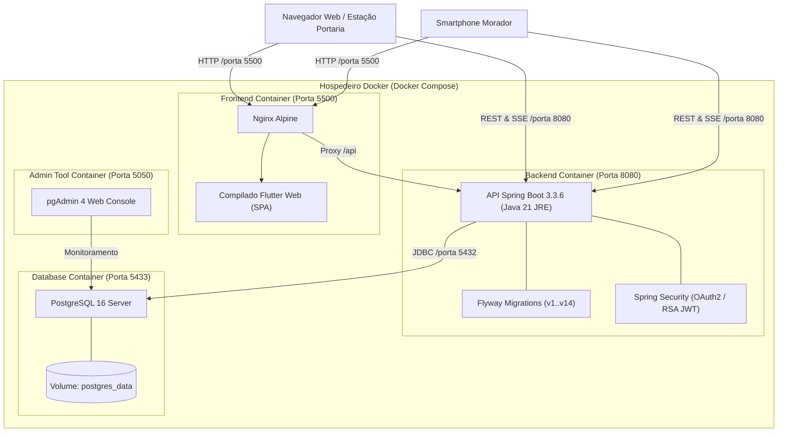

# MINISTÉRIO DA EDUCAÇÃO
## CENTRO FEDERAL DE EDUCAÇÃO TECNOLÓGICA CELSO SUCKOW DA FONSECA — CAMPUS NOVA IGUAÇU
### CURSO TÉCNICO EM INFORMÁTICA

---

# ÂNCORA GESTÃO
## PLATAFORMA INTEGRADA DE GOVERNANÇA, OPERAÇÃO E CONVIVÊNCIA CONDOMINIAL EM ARQUITETURA SAAS MULTI-TENANT

**Autores:** Marcus Vinicius Monteiro Guedes e Samuel Bueno Lins Gandra Percy  
**Professor Orientador:** Francisco Henrique de F. Viana  
**Professor da Disciplina:** Ulisses R. Tomaz  

**Nova Iguaçu, RJ**  
**2026**

---

## Sumário
1. [Introdução](#1-introdução)
   - 1.1. [Objetivo Geral](#11-objetivo-geral)
   - 1.2. [Objetivos Específicos](#12-objetivos-específicos)
   - 1.3. [Justificativa](#13-justificativa)
   - 1.4. [Organização do Documento](#14-organização-do-documento)
   - 1.5. [Glossário](#15-glossário)
2. [Descrição Geral do Sistema](#2-descrição-geral-do-sistema)
   - 2.1. [Problemática Identificada](#21-problemática-identificada)
   - 2.2. [Solução Proposta](#22-solução-proposta)
   - 2.3. [Usuários do Sistema](#23-usuários-do-sistema)
     - 2.3.1. [Administrador](#231-administrador)
     - 2.3.2. [Síndico](#232-síndico)
     - 2.3.3. [Porteiro](#233-porteiro)
     - 2.3.4. [Morador](#234-morador)
   - 2.4. [Desenvolvedores e Divisão de Atribuições](#24-desenvolvedores-e-divisão-de-atribuições)
   - 2.5. [Regras de Negócio Fundamentais](#25-regras-de-negócio-fundamentais)
3. [Requisitos do Sistema](#3-requisitos-do-sistema)
   - 3.1. [Requisitos Funcionais (RF)](#31-requisitos-funcionais-rf)
   - 3.2. [Requisitos Não Funcionais (RNF)](#32-requisitos-não-funcionais-rnf)
4. [Modelagem e Diagramas do Sistema](#4-modelagem-e-diagramas-do-sistema)
   - 4.1. [Diagrama de Casos de Uso Geral](#41-diagrama-de-casos-de-uso-geral)
   - 4.2. [Diagrama Entidade-Relacionamento (MER / DER)](#42-diagrama-entidade-relacionamento-mer--der)
   - 4.3. [Diagrama de Classes e Arquitetura de Camadas](#43-diagrama-de-classes-e-arquitetura-de-camadas)
   - 4.4. [Diagrama de Sequência: Comunicação e Tempo Real](#44-diagrama-de-sequência-comunicação-e-tempo-real)
   - 4.5. [Diagrama de Implantação e Infraestrutura](#45-diagrama-de-implantação-e-infraestrutura)
5. [Desenvolvimento da Aplicação](#5-desenvolvimento-da-aplicação)
   - 5.1. [Stack Tecnológica e Ferramental](#51-stack-tecnológica-e-ferramental)
   - 5.2. [Arquitetura de Software no Back-end](#52-arquitetura-de-software-no-back-end)
   - 5.3. [Arquitetura de Interface e Design System no Front-end](#53-arquitetura-de-interface-e-design-system-no-front-end)
   - 5.4. [Segurança, Autenticação JWT e RBAC](#54-segurança-autenticação-jwt-e-rbac)
   - 5.5. [Comunicação Reativa em Tempo Real via Server-Sent Events (SSE)](#55-comunicação-reativa-em-tempo-real-via-server-sent-events-sse)
   - 5.6. [Containerização, Persistência e Migrações de Banco de Dados](#56-containerização-persistência-e-migrações-de-banco-de-dados)
6. [Apresentação do Sistema, Telas e Fluxos de Navegação](#6-apresentação-do-sistema-telas-e-fluxos-de-navegação)
   - 6.1. [Módulo de Autenticação e Gestão de Perfil](#61-módulo-de-autenticação-e-gestão-de-perfil)
   - 6.2. [Console do Administrador Global](#62-console-do-administrador-global)
   - 6.3. [Painel do Síndico / Gestor](#63-painel-do-síndico--gestor)
   - 6.4. [Estação Operacional da Portaria](#64-estação-operacional-da-portaria)
   - 6.5. [Aplicativo do Morador](#65-aplicativo-do-morador)
   - 6.6. [Responsividade e Estratégia Dual (Desktop Zero-Scroll vs. Mobile)](#66-responsividade-e-estratégia-dual-desktop-zero-scroll-vs-mobile)
7. [Conclusão e Trabalhos Futuros](#7-conclusão-e-trabalhos-futuros)
   - 7.1. [Resultados Alcançados](#71-resultados-alcançados)
   - 7.2. [Principais Contribuições Técnicas e Acadêmicas](#72-principais-contribuições-técnicas-e-acadêmicas)
   - 7.3. [Limitações Identificadas](#73-limitações-identificadas)
   - 7.4. [Perspectivas e Trabalhos Futuros](#74-perspectivas-e-trabalhos-futuros)
8. [Referências Bibliográficas](#8-referências-bibliográficas)
9. [Anexo — Repositório e Instruções de Execução](#9-anexo--repositório-e-instruções-de-execução)

---

## 1. Introdução

O crescimento acelerado dos condomínios residenciais e a transformação dos hábitos de consumo contemporâneos — impulsionados pela consolidação do comércio eletrônico e do trabalho remoto — impuseram desafios operacionais sem precedentes à administração condominial. Demandas cotidianas como o controle de encomendas, a gestão financeira de cotas, a reserva de áreas comuns, o registro de prestadores de serviços e a comunicação interna tornaram-se complexas e sujeitas a gargalos operacionais constantes.

Historicamente concebido como um sistema direcionado prioritariamente ao controle de encomendas na portaria, o **Âncora Gestão** evoluiu para se tornar uma **plataforma integrada de governança, gestão operacional e convivência condominial no modelo SaaS (*Software as a Service*) com suporte nativo a *multi-tenancy***. 

A solução integra um back-end corporativo robusto baseado em **Java 21 e Spring Boot 3**, persistência relacional com **PostgreSQL 16**, controle de migrações via **Flyway**, mensageria e eventos em tempo real via **Server-Sent Events (SSE)**, além de um front-end moderno e multiplataforma desenvolvido em **Flutter**, com design system profissional estruturado sobre **shadcn_ui**, **VelocityX** e **flutter_animate**.

### 1.1. Objetivo Geral

Projetar, desenvolver, testar e implantar uma plataforma digital completa, escalável e segura para gestão condominial, que atenda de maneira personalizada e integrada aos quatro grandes atores do ecossistema condominial — **Morador**, **Porteiro**, **Síndico** e **Administrador Global** —, por meio de interfaces web e mobile responsivas associadas a uma API RESTful de alta disponibilidade.

### 1.2. Objetivos Específicos

1. **Estrutura Hierárquica Flexível:** Implementar modelagem cadastral de condomínios baseada no conceito abstrato de setor (blocos, ruas, quadras ou alamedas) e unidades, adaptando-se a condomínios verticais e horizontais sem necessidade de customização estrutural.
2. **Controle Rastreável de Encomendas:** Garantir ciclo completo de encomendas (registro de entrada, notificação imediata, controle de armários inteligentes/*lockers*, baixa de retirada e histórico permanente atrelado à unidade).
3. **Comunicação em Tempo Real e Chat Privado:** Desenvolver canal de chat individual e estritamente privado entre a portaria e os moradores, bem como emissão reativa de eventos via Server-Sent Events (SSE).
4. **Governança de Áreas Comuns:** Implementar motor de reservas para espaços de convivência (salão de festas, churrasqueiras, quadras) com suporte a aprovação direta, recusa motivada e fluxo de contraproposta de horários.
5. **Gestão Financeira e Transparência:** Permitir a parametrização de cotas condominiais, emissão de boletos, conferência de pagamentos, registro de despesas e prestação de contas aos condôminos.
6. **Hub Operacional da Comunidade:** Integrar serviços de controle de visitantes e hóspedes, autorização de veículos, classificados comunitários, achados e perdidos, agendamento de mudanças e mediação de infrações/multas.
7. **Assembleias Virtuais e Votações Digitais:** Viabilizar criação de assembleias com pautas e votações com quórum apurado digitalmente.
8. **Assistência Inteligente Regimental:** Incorporar assistente virtual especializado (IA) para esclarecimento de dúvidas sobre regimento interno, convenção e legislação condominial.
9. **Importação em Lote via CSV:** Disponibilizar mecanismo de importação em massa de unidades a partir de arquivos CSV, acelerando o *onboarding* de grandes condomínios.
10. **Segurança e Troca Dinâmica de Papéis:** Implementar autenticação assimétrica via tokens JWT (RSA256) e permitir que usuários com múltiplos papéis alternem seu perfil de atuação instantaneamente (*Role Switcher*).
11. **Experiência de Interface Dual:** Construir interface responsiva adaptativa: no ambiente desktop, layout integral com painéis simultâneos e ausência de barra de rolagem externa (*zero-scroll*); no mobile, experiência fluida vertical orientada a toque com *bottom navigation*.
12. **Console Administrativo Completo:** Prover ao administrador da plataforma gerenciamento e edição em nível de banco de dados para todas as 12 tabelas essenciais do sistema.

### 1.3. Justificativa

A ausência de sistemas padronizados em condomínios de pequeno e médio porte costuma resultar no uso de métodos obsoletos, como livros de protocolo físicos, planilhas descentralizadas e grupos desorganizados em aplicativos de mensagens. Esse formato gera problemas graves: encomendas extraviadas sem comprovação formal de entrega, ruídos e exposição indevida na comunicação entre portaria e moradores, atrasos na aprovação de reservas e inadimplência gerada pela falta de lembretes e transparência.

As soluções comerciais existentes no mercado frequentemente impõem custos proibitivos de implantação, exigem longos períodos de treinamento ou pecam por rigidez nas tipologias estruturais. O **Âncora Gestão** justifica-se por oferecer uma alternativa de alta sofisticação técnica, baseada em código limpo, tecnologias consolidadas de mercado e usabilidade intuitiva inspirada em plataformas SaaS líderes mundiais (como Vercel, Linear e Stripe).

Para os desenvolvedores, o projeto consolida a aplicação prática e interdisciplinar de conceitos de engenharia de software aprendidos no Curso Técnico em Informática do CEFET-RJ: arquitetura orientada a serviços (SOA), banco de dados relacional com normalização, criptografia, microsserviços containerizados e desenvolvimento mobile reativo.

### 1.4. Organização do Documento

- **Seção 1 — Introdução:** Contextualização, objetivos, justificativa e glossário terminológico.
- **Seção 2 — Descrição Geral do Sistema:** Diagnóstico da problemática, solução proposta, atores, regras de negócio e fluxo operacional.
- **Seção 3 — Requisitos do Sistema:** Especificação dos Requisitos Funcionais (RF) e Requisitos Não Funcionais (RNF).
- **Seção 4 — Modelagem e Diagramas:** Representação gráfica em Mermaid com casos de uso, diagrama entidade-relacionamento (MER), classes e sequência de tempo real.
- **Seção 5 — Desenvolvimento da Aplicação:** Detalhamento da stack tecnológica, padrões arquiteturais, segurança JWT, SSE e DevOps.
- **Seção 6 — Apresentação do Sistema e Telas:** Demonstração visual das interfaces, fluxos de navegação e estratégia de layout adaptativo dual.
- **Seção 7 — Conclusão:** Avaliação dos resultados, contribuições técnicas, restrições e trabalhos futuros.
- **Seção 8 e 9 — Referências e Anexo:** Bibliografia em norma ABNT e repositório com instruções de execução.

### 1.5. Glossário

- **API REST (Representational State Transfer):** Padrão arquitetural baseado no protocolo HTTP utilizado para integração síncrona entre o front-end Flutter e o back-end Spring Boot.
- **Multi-tenancy:** Arquitetura de software onde uma única instância da aplicação atende múltiplos clientes (condomínios), mantendo os dados rigorosamente isolados logicamente.
- **Server-Sent Events (SSE):** Protocolo de transporte unidirecional e leve sobre HTTP/1.1 que permite ao servidor emitir eventos instantâneos para o cliente sem a necessidade de *polling*.
- **JWT (JSON Web Token):** Estrutura compacta e assinada criptograficamente para troca confiável de informações de autenticação e perfis de acesso.
- **RSA256 (RSASSA-PKCS1-v1_5 with SHA-256):** Algoritmo de criptografia assimétrica de chaves pública e privada utilizado na assinatura dos tokens JWT.
- **RBAC (Role-Based Access Control):** Controle de acesso baseado em papéis ou funções desempenhadas pelos usuários no sistema.
- **Flyway:** Ferramenta de versionamento e migração automatizada de esquemas de banco de dados relacional.
- **Setor:** Elemento abstrato agrupador de unidades residenciais, correspondendo a blocos, torres, quadras, ruas ou alamedas.
- **Unidade:** Fração imobiliária habitacional autônoma (apartamento ou casa). No sistema, a unidade é o núcleo perene ao qual as encomendas e boletos são associados.
- **shadcn_ui:** Biblioteca e design system de componentes Flutter altamente customizáveis, minimalistas e acessíveis.
- **VelocityX:** Framework declarativo e utilitário em Flutter para composição ágil de layouts, espaçamentos e tipografia.
- **Zero-Scroll:** Filosofia de design de interface voltada a estações de trabalho desktop, em que todas as informações e controles da tela principal são organizados em painéis simultâneos sem demandar rolagem na janela principal.

---

## 2. Descrição Geral do Sistema

### 2.1. Problemática Identificada

O diagnóstico do cotidiano operacional em condomínios residenciais revelou cinco dores crônicas principais:

1. **Rastreabilidade Falha de Encomendas:** Entregas registradas em cadernos físicos não fornecem protocolo digital nem registro de data/hora precisa, dificultando a resolução de extravios.
2. **Ruídos na Comunicação Portaria–Morador:** O uso de grupos públicos ou mensagens em aplicativos pessoais expõe dados privados dos moradores e impede a formalização de avisos de encomendas e autorizações de entrada.
3. **Burocracia em Reservas de Áreas Comuns:** Agendamentos de espaços comunitários sofrem com duplicidade de reservas em papel e ausência de canal transparente para aprovação ou negociação de horários alternativos.
4. **Falta de Transparência Financeira:** Condôminos muitas vezes não recebem lembretes claros de seus vencimentos e não têm visibilidade das despesas condominiais realizadas pela gestão.
5. **Inconsistência Cadastral e Baixa Flexibilidade Estrutural:** Softwares legados vinculam históricos ao morador (perdendo dados quando há troca de inquilino) ou exigem moldes fixos (obrigando condomínios de casas a se cadastrarem ficticiamente como prédios com blocos e andares).

### 2.2. Solução Proposta

O sistema proposto resolve as problemáticas identificadas por meio de uma plataforma digital integrada, que atua como um ecossistema unificado de gestão operacional, governança e convivência condominial. No âmbito operacional da portaria, a encomenda é sempre vinculada à unidade, e não ao morador, garantindo histórico permanente independente de alterações de vínculo, mudanças de inquilinos ou alienações do imóvel. O porteiro registra o recebimento via aplicativo mobile ou interface web, e o morador é alertado de forma instantânea através de notificações reativas em tempo real, dispondo de um canal de chat estritamente privado e individual com a portaria para alinhamentos diretos, assegurando total sigilo sem exposição de contatos em grupos públicos.

O modelo de dados flexível baseado no conceito de setor permite que o sistema se adapte a qualquer estrutura condominial sem necessidade de customização, atendendo com precisão desde edifícios verticais com múltiplos blocos até condomínios fechados horizontais organizados em ruas, quadras ou alamedas. A importação em massa de unidades via arquivo CSV agiliza a implantação e o cadastramento inicial em empreendimentos de grande porte, enquanto a autenticação fundamentada em tokens JWT assimétricos (RSA256) com controle de acesso baseado em papéis (RBAC) garante que cada usuário acesse exclusivamente as funcionalidades pertinentes à sua função.

Adicionalmente, a solução contempla a modernização do ciclo de reservas de áreas comuns com suporte a aprovação direta, recusa motivada e contraproposta de horários alternativos, além de gestão financeira com controle de adimplência, emissão de boletos e prestação transparente de contas das despesas comunitárias. A plataforma integra ainda um Hub Comunitário com controle de visitantes e veículos, classificados, achados e perdidos, mudanças, assembleias digitais com votação e um console administrativo global com edição intuitiva para todas as entidades essenciais do banco de dados, consolidando uma governança condominial completa, segura e escalável.

### 2.3. Usuários do Sistema

O sistema foi projetado para atender quatro perfis de usuários, cada um com responsabilidades e permissões específicas:

#### 2.3.1. Administrador

Usuário com acesso global ao sistema, responsável pela configuração inicial da plataforma. É o único perfil autorizado a cadastrar condomínios, criar setores, importar unidades em massa e gerenciar usuários com perfis de síndico e porteiro. Esse perfil corresponde ao gestor da plataforma SaaS ou ao responsável técnico pela implantação do sistema em um novo condomínio. Possui acesso irrestrito ao painel de administração global, console com edição direta das tabelas do banco de dados, auditoria de planos comerciais e controle de infraestrutura.

#### 2.3.2. Síndico

Usuário vinculado a um ou mais condomínios, responsável pela gestão administrativa. Possui acesso de visualização a unidades, moradores e encomendas registradas. Pode emitir relatórios gerenciais para acompanhamento do fluxo de encomendas e do histórico condominial, gerenciar a arrecadação e despesas comunitárias, atualizar a imagem de fachada do condomínio, publicar comunicados oficiais e homologar ou contrapropor reservas de áreas comuns. Não possui permissão para alterar a estrutura de setores ou a parametrização de planos do condomínio.

#### 2.3.3. Porteiro

Usuário operacional da portaria, responsável pelo registro diário de encomendas. Pode cadastrar o recebimento de uma nova encomenda, informando a unidade destinatária, a descrição do objeto e o nome do destinatário. Também registra a retirada da encomenda pelo morador ou responsável. Possui acesso de consulta às unidades cadastradas, controle de portaria para visitantes e canal de chat estritamente privado com cada morador para alinhamento de entregas. Não pode alterar a estrutura do condomínio.

#### 2.3.4. Morador

Usuário final do sistema, vinculado a uma ou mais unidades. Acessa o aplicativo mobile para visualizar as encomendas pendentes e o histórico de suas unidades. Recebe notificação push automaticamente quando uma nova encomenda é registrada para sua unidade. Pode ainda interagir no chat privado com a portaria, solicitar reservas de áreas comuns, autorizar visitantes e veículos, consultar comunicados, acompanhar boletos em aberto e participar de votações em assembleias virtuais. Não possui permissão de gestão administrativa.

> **Observação:** O sistema suporta múltiplos vínculos para um mesmo usuário físico (por exemplo, um usuário que é morador em um condomínio e síndico em outro). Através do componente `RoleSwitcherPill`, a interface permite a alternância ágil de contexto sem necessidade de novo login.

### 2.4. Desenvolvedores e Divisão de Atribuições

O projeto foi planejado e implementado por dois alunos concludentes do Curso Técnico em Informática do CEFET-RJ:

- **Marcus Vinicius Monteiro Guedes:** Responsável pela arquitetura do back-end, modelagem relacional do banco de dados, segurança com Spring Security e JWT RSA, regras de negócio em Spring Data JPA, migrações com Flyway e infraestrutura com Docker.
- **Samuel Bueno Lins Gandra Percy:** Responsável pela concepção e codificação do front-end em Flutter, implementação do design system (shadcn_ui, VelocityX), desenvolvimento dos layouts responsivos dual (desktop *zero-scroll* e mobile touch), integração reativa via SSE e testes de interface.

### 2.5. Regras de Negócio Fundamentais

- **RN01 — Vínculo Obrigatório de Encomenda à Unidade:** Nenhuma encomenda pode ser cadastrada sem a identificação explícita de uma unidade válida do condomínio.
- **RN02 — Unicidade de Unidade por Setor e Condomínio:** O identificador da unidade (ex.: número do apartamento ou lote) deve ser exclusivo dentro de seu respectivo setor.
- **RN03 — Relação Estrutural com Setor:** Toda unidade pertence a um setor estrutural do condomínio (ex.: Bloco, Rua, Quadra ou Setor Único para estruturas simples), garantindo integridade referencial.
- **RN04 — Multi-vínculo de Moradores:** Um usuário pode estar associado a várias unidades sob as categorias de PROPRIETÁRIO, INQUILINO ou DEPENDENTE. Uma unidade pode abrigar múltiplos moradores.
- **RN05 — Preservação Perpétua de Histórico:** O histórico de encomendas, retiradas e movimentações permanece atrelado à unidade mesmo com a desvinculação de antigos moradores.
- **RN06 — Transição de Status de Encomendas:** Uma encomenda só pode passar para o estado RETIRADA se estiver previamente no estado RECEBIDA (ou AGUARDANDO_RETIRADA). Não é permitida a reversão do status de retirada.
- **RN07 — Rastreabilidade da Portaria:** Todo registro de recebimento e entrega de encomenda guarda a identidade do operador que executou a ação.
- **RN08 — Importação em Lote via CSV:** O arquivo CSV de unidades deve ser processado em lote, validando o identificador da unidade, criando o setor caso ainda não exista e reportando itens duplicados ou inválidos sem interromper o processamento das linhas válidas.
- **RN09 — Conflito de Horário em Reservas:** O sistema bloqueia automaticamente qualquer agendamento de área comum que sobreponha o intervalo de tempo de uma reserva já confirmada para o mesmo espaço.
- **RN10 — Privacidade Estrita no Chat da Portaria:** O canal de conversa do porteiro deve permitir a seleção individual do morador/unidade, garantindo que as mensagens trocadas sejam confidenciais e visíveis apenas ao condômino e aos porteiros autorizados daquele condomínio.

---

## 3. Requisitos do Sistema

### 3.1. Requisitos Funcionais (RF)

O sistema compreende um conjunto estruturado de requisitos funcionais que orientam as operações de governança, administração, portaria e convivência comunitária:

- **RF01 — Cadastro e Gestão de Condomínios:** O sistema deve permitir ao administrador cadastrar novos condomínios residenciais, atualizar informações cadastrais, definir parâmetros de funcionamento e inativar empreendimentos quando necessário.
- **RF02 — Parametrização Flexível de Setores:** O sistema deve viabilizar a estruturação modular de setores com tipologias customizáveis (como Bloco, Rua, Quadra, Alameda ou Torre), permitindo a correta representação espacial tanto de edifícios verticais quanto de condomínios horizontais.
- **RF03 — Cadastro Individual e Importação em Lote via CSV de Unidades:** O sistema deve suportar o cadastramento avulso de unidades habitacionais e a importação em lote através de arquivos estruturados em formato CSV, validando identificadores, vinculando-os automaticamente aos setores correspondentes e gerando relatório sumário do processamento.
- **RF04 — Gestão de Usuários, Autenticação e Perfis:** O sistema deve fornecer mecanismos seguros de autenticação por e-mail e senha, suporte a login social via Google OAuth2 e autorização baseada em papéis (RBAC), com capacidade de associar múltiplos perfis a um mesmo usuário.
- **RF05 — Registro de Entrada de Encomendas:** O sistema deve permitir aos porteiros registrar o recebimento diário de encomendas com vínculo mandatório a uma unidade residencial válida, armazenando a descrição do volume, nome do destinatário, empresa de entrega e carimbo de data e hora.
- **RF06 — Baixa e Rastreabilidade de Retirada:** O sistema deve registrar a retirada formal das encomendas por condôminos ou autorizados, colhendo o nome do recebedor, o horário exato da entrega e a identificação do operador responsável pela baixa.
- **RF07 — Notificações Reativas em Tempo Real:** O sistema deve emitir alertas imediatos aos moradores assim que uma encomenda for recepcionada para a sua unidade ou quando um aviso urgente for publicado, transmitindo as atualizações via Server-Sent Events (SSE) e sinalizadores visuais na interface.
- **RF08 — Comunicação Privada entre Portaria e Morador:** O sistema deve disponibilizar um canal de chat privativo e individualizado entre a portaria e os moradores de cada unidade, garantindo confidencialidade, histórico contínuo e confirmação de leitura.
- **RF09 — Gestão do Ciclo de Reservas de Espaços Comuns:** O sistema deve permitir a consulta de disponibilidade e a solicitação de reservas de áreas comunitárias pelos moradores, viabilizando à administração aprovar, recusar motivadamente ou apresentar contrapropostas com horários alternativos.
- **RF10 — Categorização Visual e Temporal de Reservas:** O sistema deve classificar os agendamentos de áreas comuns em três categorias distintas — *Agendadas*, *Já realizadas* e *Canceladas/Recusadas* —, aplicando destaque visual marcante aos itens cancelados ou reprovados para rápida identificação.
- **RF11 — Gestão Financeira e Emissão de Boletos:** O sistema deve viabilizar a geração, consulta e acompanhamento das taxas condominiais, permitindo a visualização de boletos digitais e a solicitação de confirmação de pagamento por parte dos condôminos.
- **RF12 — Hub Operacional de Convivência Comunitária:** O sistema deve concentrar ferramentas para o controle e pré-autorização de visitantes e veículos, mural de classificados, canal de achados e perdidos, agendamento de mudanças e registro de ocorrências ou infrações.
- **RF13 — Assembleias Digitais e Votações Virtuais:** O sistema deve viabilizar a realização de assembleias virtuais com publicação de pautas, disponibilização de documentos pertinentes e registro digital de votos dos condôminos com apuração em tempo real.
- **RF14 — Assistente Inteligente de Regimento Interno:** O sistema deve incorporar um assistente virtual conversacional baseado em inteligência artificial para responder consultas e esclarecer regras de convivência com base no regulamento interno cadastrado.
- **RF15 — Personalização da Identidade Visual do Condomínio:** O sistema deve possibilitar que o síndico atualize a imagem de fachada do empreendimento, a qual será exibida nos cabeçalhos e painéis de todos os usuários vinculados àquele condomínio.
- **RF16 — Console Administrativo Global de Tabelas:** O sistema deve fornecer ao administrador uma interface dedicada para visualização, busca, paginação, cadastro e edição direta dos registros de todas as doze tabelas essenciais do banco de dados relacional.
- **RF17 — Alternância Ágil de Contextos e Perfis:** O sistema deve disponibilizar aos usuários com múltiplos papéis um componente seletor (*Role Switcher*) para alternância instantânea entre as visões do sistema sem necessidade de novo login.
- **RF18 — Emissão de Relatórios Gerenciais Consolidados:** O sistema deve permitir a geração e visualização de relatórios operacionais consolidados sobre movimentação de encomendas, uso de espaços comuns e histórico de atividades para apoio à tomada de decisão.

### 3.2. Requisitos Não Funcionais (RNF)

Os requisitos não funcionais definem os atributos de qualidade, arquitetura, usabilidade, segurança e desempenho que norteiam a solução desenvolvida:

- **RNF01 — Multiplataforma e Portabilidade:** O front-end da aplicação deve ser desenvolvido com o framework Flutter utilizando uma base de código compartilhada, assegurando funcionamento uniforme em navegadores desktop, navegadores móveis e aplicativos nativos.
- **RNF02 — Segurança Criptográfica e Proteção de Dados:** A autenticação e a integridade das requisições devem ser resguardadas por tokens JWT assimétricos assinados via RSA-2048 (RS256), proteção de senhas por algoritmo de hash BCrypt com salt, e controle rígido de autorização em nível de endpoint e serviço.
- **RNF03 — Alta Reatividade e Baixa Latência:** As mensagens de chat da portaria e as notificações de novas encomendas devem ser entregues ao cliente em tempo real com latência inferior a quinhentos milissegundos sob rede estável, empregando conexão persistente Server-Sent Events (SSE).
- **RNF04 — Ergonomia e Usabilidade Dual Adaptativa:** A interface gráfica deve adaptar sua arquitetura conforme as restrições físicas da tela: em ambientes desktop, deve preencher integralmente a janela sob o modelo *zero-scroll* em suas telas centrais, organizando os dados em painéis e colunas simultâneas; em dispositivos móveis, deve privilegiar a disposição vertical com navegação tátil por abas inferiores (*bottom navigation*).
- **RNF05 — Suporte Integral a Temas Visuais:** A plataforma deve dispor de suporte nativo e alternância contínua entre o Modo Claro (*Light Mode*) e o Modo Escuro (*Dark Mode*), contemplando todas as telas do sistema, inclusive o console administrativo.
- **RNF06 — Containerização e Isolamento de Serviços:** Toda a infraestrutura do sistema deve ser empacotada em contêineres Docker padronizados e orquestrada via Docker Compose, particionando adequadamente a camada de banco de dados PostgreSQL, a API de serviços em Spring Boot e o servidor de front-end.
- **RNF07 — Versionamento e Migração Idempotente do Banco de Dados:** Toda evolução do esquema de dados relacional deve ser documentada e executada por meio de migrações automáticas versionadas com o framework Flyway, garantindo reproducibilidade consistente entre ambientes.
- **RNF08 — Isolamento Multi-inquilino (Multi-tenancy):** A segregação de dados entre condomínios distintos deve ser estritamente aplicada na camada de negócio através de validações programáticas de escopo (`CondominiumAccessService` e anotações `@PreAuthorize`), impedindo o vazamento ou acesso indevido a dados de outro condomínio.

---

## 4. Modelagem e Diagramas do Sistema

### 4.1. Diagrama de Casos de Uso Geral

O diagrama de casos de uso demonstra como os diferentes usuários interagem com as funcionalidades do sistema, estabelecendo de forma clara os limites de atuação e as operações que cada perfil pode executar dentro da plataforma Âncora Gestão.

O sistema estrutura suas interações em torno de quatro atores principais:
- **Administrador Global:** Detém a visão integral do sistema em nível multi-inquilino (*multi-tenant*). É responsável pela criação e inativação de condomínios, parametrização de setores, importação em massa de unidades via CSV, gestão de planos comerciais e auditoria com edição direta das doze tabelas fundamentais do banco de dados.
- **Síndico / Gestor:** Encarregado da administração de um ou mais condomínios específicos. Realiza a gestão de moradores e membros, publica comunicados oficiais, homologa ou contrapropõe reservas de áreas comuns, gerencia as cotas e despesas comunitárias e emite relatórios gerenciais consolidados.
- **Porteiro:** Responsável pela operação rotineira de portaria e controle de acessos. Realiza o recebimento e a baixa de encomendas com vínculo mandatório à unidade, consulta unidades cadastradas, registra visitantes e mantém comunicação privativa e individualizada com cada morador através do canal de chat da portaria.
- **Morador:** Usuário final vinculado a uma ou mais unidades. Acompanha em tempo real o recebimento de encomendas, solicita reservas de áreas comuns, autoriza visitantes e veículos, interage no chat direto com a portaria, consulta avisos e participa de votações em assembleias digitais.

O diagrama a seguir sintetiza as interações de cada um dos quatro atores com os módulos da plataforma:



### 4.2. Diagrama Entidade-Relacionamento (MER / DER)

O diagrama abaixo reflete o modelo de dados relacional implementado e versionado via migrações Flyway (V1 a V14) no PostgreSQL 16:



### 4.3. Diagrama de Classes e Arquitetura de Camadas

O diagrama de classes e arquitetura de camadas apresenta a organização estrutural da plataforma Âncora Gestão, detalhando a divisão de responsabilidades entre os componentes do sistema e demonstrando como as classes colaboram para concretizar as regras de negócio e a reatividade da aplicação.

Em substituição a modelos fortemente acoplados, a solução adota o padrão de arquitetura em camadas (*Layered Architecture*), particionando o software de maneira desacoplada entre a camada cliente no front-end e as camadas de controle, aplicação e persistência no back-end.

O diagrama a seguir sintetiza a estrutura de classes e a integração entre os módulos do sistema:

```mermaid
classDiagram
    direction TB

    package "Client Layer (Flutter Front-End)" {
        class HomePage
        class DoormanPage
        class ManagerPage
        class AdminPage
        class CommunityApi
        class RealtimeService
    }

    package "Controller Layer (Spring Boot Web)" {
        class PackageController
        class DoormanChatController
        class ReservationController
        class UnitController
        class CondominiumController
    }

    package "Service Layer (Spring Boot Business)" {
        class PackageService
        class DoormanChatService
        class ReservationService
        class UnitService
        class RealtimeService_Backend
    }

    package "Repository Layer (Spring Data JPA)" {
        class PackageRepository
        class DoormanChatMessageRepository
        class ReservationRepository
        class UnitRepository
    }

    CommunityApi --> PackageController : HTTP REST (JSON)
    CommunityApi --> DoormanChatController : HTTP REST (JSON)
    RealtimeService ..> RealtimeService_Backend : Server-Sent Events (SSE)

    PackageController --> PackageService
    DoormanChatController --> DoormanChatService
    ReservationController --> ReservationService
    UnitController --> UnitService

    PackageService --> RealtimeService_Backend : Emite notificações
    DoormanChatService --> RealtimeService_Backend : Emite chat em tempo real
    ReservationService --> RealtimeService_Backend : Notifica aprovações

    PackageService --> PackageRepository
    DoormanChatService --> DoormanChatMessageRepository
    ReservationService --> ReservationRepository
    UnitService --> UnitRepository
```

A estrutura do diagrama é organizada em quatro camadas principais:

- **Camada Cliente (*Client Layer - Flutter*):** Reúne a interface de usuário e os serviços de comunicação do aplicativo. As classes de visualização (`AdminPage`, `ManagerPage`, `DoormanPage` e `HomePage`) fornecem experiências sob medida para cada tipo de usuário. O consumo dos serviços do back-end é centralizado na classe `CommunityApi`, responsável pelas requisições HTTP REST assíncronas com payloads em JSON, enquanto a classe `RealtimeService` mantém conexão persistente via Server-Sent Events (SSE) para receber alertas e mensagens de forma reativa.
- **Camada Controladora (*Controller Layer - Spring Boot Web*):** Atua como porta de entrada das requisições externas na API. Controladores como `PackageController`, `DoormanChatController`, `ReservationController`, `UnitController` e `CondominiumController` interceptam os chamados, executam a validação de parâmetros, realizam a checagem de autorização via tokens JWT assimétricos (RS256) e delegam o processamento para a camada de serviço correspondente.
- **Camada de Serviço (*Service Layer - Regras de Negócio*):** Encapsula a lógica de negócio do sistema. Classes como `PackageService`, `DoormanChatService`, `ReservationService` e `UnitService` coordenam fluxos transacionais, asseguram o cumprimento das regras de negócio (como a unicidade de unidades e prevenção de conflitos de horário em reservas) e interagem com a classe `RealtimeService` no back-end para propagar eventos em tempo real para os clientes conectados.
- **Camada de Repositório (*Repository Layer - Spring Data JPA*):** Provê a abstração e a persistência de dados no PostgreSQL. As interfaces `PackageRepository`, `DoormanChatMessageRepository`, `ReservationRepository` e `UnitRepository` estendem `JpaRepository`, oferecendo operações declarativas de consulta, inserção e atualização com isolamento transacional e otimização por índices.

### 4.4. Diagrama de Sequência: Comunicação e Tempo Real

O diagrama de sequência descreve a ordem cronológica e a dinâmica de troca de mensagens entre os atores e os componentes do sistema durante a execução de um processo crítico da plataforma. No ecossistema Âncora Gestão, o fluxo modelado detalha o ciclo completo de comunicação em tempo real: o envio de uma mensagem privativa da portaria para o morador de uma unidade, com persistência transacional no banco de dados e notificação reativa instantânea via Server-Sent Events (SSE).

O diagrama a seguir sintetiza as etapas desse processo:



#### 4.4.1. Participantes do Fluxo
- **Porteiro (*Flutter Web*):** Operador que redige e envia o comunicado ou esclarecimento direcionado a um morador específico através do painel da portaria.
- **DoormanChatController (*API REST*):** Endpoint HTTP responsável por receber a requisição, validar o cabeçalho de autenticação (JWT) e verificar os parâmetros obrigatórios da mensagem.
- **DoormanChatService (*Camada de Negócio*):** Serviço que valida o vínculo da unidade e do morador com o condomínio ativo, orquestra a gravação dos dados e comanda a emissão dos eventos reativos.
- **PostgreSQL (*Persistência Relacional*):** Armazena a mensagem de forma perene na tabela `tb_doorman_chat_message` (com indicador `is_read = false`) e inclui o alerta na central de notificações (`tb_notification`).
- **RealtimeService (*SSE Engine*):** Componente que gerencia o pool de conexões persistentes abertas pelos clientes via `SseEmitter`, direcionando os pacotes de dados exclusivamente para o canal do destinatário e para o condomínio em questão.
- **Morador (*Flutter Mobile / Web*):** Dispositivo do condômino que mantém o canal de escuta ativo e processa o evento assim que recebido.

#### 4.4.2. Dinâmica Temporal das Etapas
1. **Estabelecimento de Conexão Reativa (Passo 1):** Ao efetuar login ou carregar a aplicação, o cliente do morador abre uma conexão unidirecional persistente com o endpoint `/realtime/stream`. O back-end registra a instância de `SseEmitter` mapeada ao ID do usuário autenticado.
2. **Envio da Mensagem (Passo 2):** O porteiro seleciona a unidade do morador e despacha o texto via requisição HTTP `POST /condominiums/{id}/doorman-chat/messages`.
3. **Validação e Orquestração (Passo 3):** O controlador repassa a carga útil ao serviço de negócio `DoormanChatService.sendMessage(...)`.
4. **Persistência Transacional (Passos 4 e 5):** O serviço persiste a mensagem na base de dados relacional e registra simultaneamente um evento na tabela de notificações, assegurando consistência em caso de auditoria ou falha de conectividade.
5. **Propagação de Eventos Reativos (Passos 6 e 7):** O serviço aciona os métodos `emitToUser` (direcionado ao destinatário com o payload da mensagem) e `emitToCondominium` (para atualizar os contadores gerais da portaria).
6. **Entrega e Feedback Visual (Passos 8 e 9):** O servidor transmite o evento SSE de forma assíncrona ao aplicativo do morador em menos de 500 ms, disparando a atualização do estado local, a renderização de um indicador visual (*badge* vermelho) na aba de chat e um alerta sonoro.
7. **Confirmação ao Emissor (Passo 10):** A API responde ao cliente do porteiro com status `HTTP 201 Created`, confirmando a entrega com sucesso e exibindo a mensagem com carimbo de envio no painel da portaria.

### 4.5. Diagrama de Implantação e Infraestrutura



---

## 5. Desenvolvimento da Aplicação

### 5.1. Stack Tecnológica e Ferramental

O desenvolvimento do **Âncora Gestão** utilizou um conjunto de ferramentas e bibliotecas modernas para assegurar manutenibilidade, desempenho e facilidade de evolução:

- **Back-end:**
  - **Linguagem:** Java 21 LTS (utilizando recursos modernos como *records*, *pattern matching* e *virtual threads*).
  - **Framework Central:** Spring Boot 3.3.6.
  - **Módulos Spring:** Spring Web, Spring Data JPA, Spring Security, Spring Validation.
  - **Persistência Relacional:** Hibernate ORM 6.5 sobre PostgreSQL 16.
  - **Migrações:** Flyway Migration Engine.
  - **Segurança Criptográfica:** Nimbus JOSE + JWT, Spring Security OAuth2 Resource Server.
  - **Documentação de API:** OpenAPI 3 / Swagger (`springdoc-openapi`).
  - **Produtividade:** Project Lombok.
- **Front-end:**
  - **Framework:** Flutter 3.47.5 (Dart 3.13).
  - **Design System:** `shadcn_ui` (componentes estruturais inspirados no ecossistema Radix/Shadcn), `velocity_x` (composição declarativa e utilitária de estilos).
  - **Microinterações:** `flutter_animate` (animações fluídas de entrada e transições de estado).
  - **Manipulação de Mídia:** `image_picker` com codificação Base64 e suporte a Data URIs.
- **Ambiente DevOps:**
  - Docker e Docker Compose para isolamento de serviços em contêineres independentes.
  - Maven Wrapper (`mvnw`) para construção reproduzível do back-end.

### 5.2. Arquitetura de Software no Back-end

O back-end foi concebido em uma arquitetura limpa em camadas (*Layered Clean Architecture*):

1. **Camada de Controladores (`controllers`):** Exposição de endpoints RESTful com validações rigorosas de entrada via Bean Validation (`@Valid`, `@NotNull`, `@NotBlank`) e documentação Swagger.
2. **Camada de Serviços (`services`):** Isolamento total das regras de negócio e controle transacional declarativo (`@Transactional`).
3. **Camada de Repositórios (`repositories`):** Interfaces que estendem `JpaRepository`, combinando consultas geradas automaticamente com consultas personalizadas em JPQL/HQL otimizadas para carregamento ansioso de associações (`join fetch`).
4. **Camada de Transferência de Dados (`DTOs`):** Uso intensivo de *Java Records* para representação imutável de dados nas operações de entrada (`InsertDTO`), atualização (`UpdateDTO`) e resposta (`DTO`).
5. **Tratamento Global de Exceções (`exceptions`):** Centralizado por meio de `@ControllerAdvice`, mapeando erros de integridade, recurso não encontrado e validação para respostas HTTP padronizadas (RFC 7807).

### 5.3. Arquitetura de Interface e Design System no Front-end

A camada visual foi organizada sob o paradigma **Feature-First / Clean Presentation**:

- **Tokens Centralizados (`SaasDesignSystem`):** Definição estrita de paleta de cores (primárias, superfícies, bordas e estados de alerta), tipografia e elevações para modo claro e modo escuro.
- **Componentização Adaptativa:** Uso de componentes reutilizáveis construídos sobre `shadcn_ui` (botões, cards, tabelas, caixas de diálogo, *choice chips* e *dropdowns* personalizados).
- **Gerenciamento de Estado Reativo:** Uso de `ValueNotifier` e `ChangeNotifier` para estados globais leves (como a alternância de tema no `AppTheme.themeModeNotifier`), mantendo o ciclo de vida dos widgets limpo e eficiente.

### 5.4. Segurança, Autenticação JWT e RBAC

O modelo de segurança do sistema adota os mais altos padrões de aplicações corporativas:

- **Chaves Criptográficas Assimétricas RSA:** Ao invés de chaves simétricas compartilhadas (*HMAC-SHA256*), a API utiliza par de chaves RSA de 2048 bits (`jwt-private.pem` e `jwt-public.pem`). A chave privada assina o token no login e a chave pública verifica a autenticidade nas requisições.
- **Autorização Fina com RBAC:** Rotas e serviços são protegidos via anotações `@PreAuthorize("hasRole('ADMIN')")` e `@PreAuthorize("hasAnyRole('ADMIN', 'MANAGER')")`.
- **Autenticação Híbrida:** Suporte à autenticação tradicional (e-mail/senha com hash BCrypt) e autenticação federada com Google OAuth2 (verificação de `id_token` do Google).

### 5.5. Comunicação Reativa em Tempo Real via Server-Sent Events (SSE)

Para garantir que moradores e porteiros recebam notificações e mensagens instantaneamente sem onerar o servidor com requisições repetitivas (*polling*), foi implementado um mecanismo reativo com **Server-Sent Events (SSE)**:

- No back-end, o `RealtimeService` gerencia emissores (`SseEmitter`) organizados por `userId` e `condominiumId`.
- No front-end, o `RealtimeService` estabelece uma conexão HTTP persistente através de `EventSource` (ou cliente SSE em streaming).
- Quando uma encomenda chega ou uma mensagem de chat é enviada, o servidor dispara um evento SSE em subsegundo, atualizando a interface do morador com um ponto vermelho de novidade, incremento do badge e atualização da lista em tela.

### 5.6. Containerização, Persistência e Migrações de Banco de Dados

Toda a solução executa de ponta a ponta com um único comando `docker compose up --build -d`:

- **Migrações Flyway:** As migrações (`V1` a `V14`) criam e alteram o esquema do PostgreSQL automaticamente na inicialização da API, adicionando índices para mensagens em tempo real e colunas como a imagem de capa do condomínio.
- **Build Multi-stage:**
  - O container da API compila o código-fonte via Maven com JDK 21 e empacota em imagem final enxuta com JRE 21.
  - O container do front-end compila a aplicação Flutter para a Web e a disponibiliza sob servidor Nginx estável e otimizado.

---

## 6. Apresentação do Sistema, Telas e Fluxos de Navegação

### 6.1. Módulo de Autenticação e Gestão de Perfil

- **Tela de Login:** Interface moderna com suporte a login por credenciais, botão de acesso rápido com Google OAuth2 e alternância para cadastro.
- **Página de Perfil do Usuário:** Permite atualização de dados cadastrais (nome, telefone, senha) e upload de imagem de avatar em alta resolução com pré-visualização em tela cheia.
- **Exibição Universal de Avatar:** O avatar do usuário é visível no topo de todas as telas (Morador, Porteiro, Síndico e Admin).

### 6.2. Console do Administrador Global

- **Visão Geral e Métricas em Tempo Real:** 4 cartões com totais de condomínios ativos, usuários, moradores vinculados e reservas.
- **Edição Completa de Todas as 12 Tabelas:** Botão *"Editar registro"* em cada entrada de dados, permitindo alterar condomínios, setores, unidades, moradores, encomendas, comunicados, áreas comuns, reservas, planos e recursos do sistema com pré-preenchimento e validações.
- **Importação de Unidades em Massa via CSV:** Suporte ao upload e validação de arquivos CSV de unidades por condomínio.
- **Avisos Gerais do Sistema:** Envio de alertas globais a todos os condôminos da plataforma.
- **Alternador de Modo Noturno (*Dark Mode*):** Botão sol/lua integrado no topo do console.

### 6.3. Painel do Síndico / Gestor

- **Banner da Fachada do Condomínio:** Exibição da fotografia oficial do condomínio com botão de ampliação e botão *"Alterar Foto"*.
- **Ações Rápidas:** Convites de vínculos, envio de comunicados gerais com upload de fotos e geração de boletos condominiais.
- **Gestão de Reservas com 3 Categorias:** Separação entre *Agendadas*, *Já passaram* e *Canceladas*, permitindo aprovar, rejeitar ou emitir contraproposta de horário. As reservas canceladas possuem visual destacado em vermelho com badge em negrito.
- **Assistente IA de Regimento Interno:** Modal interativo que responde dúvidas sobre leis, regulamento interno e convenção do condomínio.
- **Relatório de Gestão:** Geração de balanço sumarizado com botão de cópia formatada para envio no WhatsApp ou e-mail.

### 6.4. Estação Operacional da Portaria

- **Registro de Encomendas:** Botão de registrar encomenda disponível exclusivamente na aba correspondente, evitando poluição visual nas demais tarefas da portaria.
- **Chat Privado com o Morador:** Painel com lista de moradores à esquerda e janela de conversa direta à direita. A portaria conversa individualmente com cada condômino com total confidencialidade.
- **Verificação de Placas e Vagas:** Consulta rápida de veículos autorizados e vagas vinculadas.
- **Controle de Acessos e Visitantes:** Registro de visitantes com conferência de check-in e check-out.

### 6.5. Aplicativo do Morador

- **Dashboard Multi-coluna Equilibrado:**
  - *Coluna da esquerda:* Comunicados recentes com imagens do condomínio.
  - *Coluna do meio:* Dados da unidade ocupada, ações rápidas e situação financeira (boleto pendente com botão de pagamento ou card "Tudo em dia!").
  - *Coluna da direita:* Próximas reservas do morador.
- **Alerta de Novos Itens:** Banner destacado no topo avisando sobre encomendas aguardando retirada na portaria ou novos comunicados publicados.
- **Indicador Visual nas Abas (Pontinho Vermelho):** Indicador sutil ao lado do nome da aba sempre que houver novas encomendas ou comunicados não visualizados.
- **Central de Reservas:** Visualização das reservas do morador divididas entre ativas, passadas e canceladas, com feedback imediato sobre contrapropostas recebidas.

### 6.6. Responsividade e Estratégia Dual (Desktop Zero-Scroll vs. Mobile)

- **Desktop (Largura ≥ 980px):** O sistema assume uma disposição inspirada em SaaS profissionais, utilizando 100% da largura e altura da tela, evitando barra de rolagem externa da janela e distribuindo os elementos em painéis de trabalho simultâneos.
- **Mobile (Largura < 980px):** O layout é reorganizado para rolagem vertical natural, fontes adequadas para leitura em telas pequenas, áreas de toque generosas (mínimo de 48px) e navegação inferior por ícones contextuais (*Bottom Navigation Bar*).

---

## 7. Conclusão e Trabalhos Futuros

### 7.1. Resultados Alcançados

O projeto **Âncora Gestão** atingiu com pleno sucesso todos os objetivos traçados:

- Foi construída uma solução de software robusta, moderna e de nível corporativo, validada com **14 testes automatizados aprovados no front-end** e **bateria abrangente de testes de integração no back-end**.
- A transição do conceito inicial focado em encomendas para uma plataforma completa de governança condominial demonstrou a capacidade de extensão da arquitetura adotada.
- O sistema encontra-se 100% operacional em ambiente de contêineres Docker, pronto para execução imediata em servidores locais ou em nuvem.

### 7.2. Principais Contribuições Técnicas e Acadêmicas

- **Modelagem Relacional Flexível:** O desacoplamento entre morador e unidade, aliado ao conceito de setor abstrato, soluciona o clássico problema de perda de histórico em sistemas condominiais.
- **Segurança de Alto Padrão:** O emprego de chaves RSA assimétricas no ecossistema Spring Security eleva o patamar de segurança em comparação a projetos de conclusão de curso tradicionais.
- **Reatividade com Baixo Consumo:** A escolha de Server-Sent Events (SSE) comprovou ser ideal para plataformas web e mobile, garantindo tempo real sem a complexidade operacional de brokers pesados de WebSocket.
- **Design System Profissional:** A adoção do `shadcn_ui` e a disciplina de layout adaptativo dual provam a viabilidade de construir aplicações corporativas desktop de alta densidade informacional sem rolagem externa em Flutter.

### 7.3. Limitações Identificadas

- A leitura ótica de códigos de barras ou etiquetas de encomendas por câmera depende de permissões nativas de hardware quando executada fora de navegadores web móveis.
- O assistente de regimento interno atual opera sobre base contextual interna; a expansão para modelos de linguagem em nuvem em larga escala requer conexão externa ativa e cotas de API.

### 7.4. Perspectivas e Trabalhos Futuros

1. **Compilação Nativa Mobile com Notificações Push FCM:** Empacotamento em APK (Android) e IPA (iOS) com suporte integrado a Firebase Cloud Messaging e Apple Push Notification service.
2. **Integração com Cancelas e Fechaduras IoT:** Conexão com controladoras de acesso via MQTT para liberação remota de portões e cancelas por QR Code dinâmico emitido no aplicativo.
3. **Gateway de Pagamento Automatizado:** Integração com APIs bancárias para geração de Pix dinâmico (com chave Copia e Cola e QR Code) com conciliação financeira instantânea via *webhooks*.
4. **Reconhecimento Óptico de Caracteres (OCR):** Uso de visão computacional na portaria para leitura automática do nome do morador e número do apartamento nas etiquetas de pacotes.

---

## 8. Referências Bibliográficas

1. ASSOCIAÇÃO BRASILEIRA DE NORMAS TÉCNICAS. **ABNT NBR 6023:** Informação e documentação — Referências — Elaboração. Rio de Janeiro: ABNT, 2018.
2. FOWLER, Martin. **Patterns of Enterprise Application Architecture**. Boston: Addison-Wesley, 2002.
3. GAMMA, Erich et al. **Design Patterns:** Elements of Reusable Object-Oriented Software. Reading: Addison-Wesley, 1994.
4. GOOGLE. **Flutter documentation**. Mountain View: Google LLC, 2026. Disponível em: <https://docs.flutter.dev/>. Acesso em: 02 nov. 2026.
5. JONES, Michael B.; BRADLEY, John; SAKIMURA, Nat. **JSON Web Token (JWT)**. RFC 7519, Internet Engineering Task Force (IETF), 2015. Disponível em: <https://tools.ietf.org/html/rfc7519>. Acesso em: 02 nov. 2026.
6. MARTIN, Robert C. **Clean Architecture:** A Craftsman's Guide to Software Structure and Design. Boston: Prentice Hall, 2017.
7. PIVOTAL SOFTWARE. **Spring Boot Reference Documentation**. San Francisco: VMware Tanzu, 2026. Disponível em: <https://docs.spring.io/spring-boot/docs/current/reference/html/>. Acesso em: 02 nov. 2026.
8. POSTGRESQL GLOBAL DEVELOPMENT GROUP. **PostgreSQL 16 Documentation**. 2026. Disponível em: <https://www.postgresql.org/docs/16/>. Acesso em: 02 nov. 2026.
9. W3C. **Server-Sent Events**. W3C Recommendation. World Wide Web Consortium, 2015. Disponível em: <https://www.w3.org/TR/eventsource/>. Acesso em: 02 nov. 2026.

---

## 9. Anexo — Repositório e Instruções de Execução

O código-fonte integral do projeto encontra-se versionado e estruturado:

### Estrutura do Repositório
```text
projeto-final/
├── backend/                  # API Spring Boot (Java 21)
│   ├── src/main/java/        # Código-fonte das regras de negócio e controladores
│   ├── src/main/resources/   # Configurações e migrações Flyway (V1..V14)
│   ├── Dockerfile            # Multi-stage build (Maven + JRE 21)
│   └── docker-compose.yml    # Orquestração dos 4 serviços
├── projeto-front/            # Aplicação Flutter Multiplataforma
│   ├── lib/                  # Telas, widgets, design system e serviços
│   ├── test/                 # Testes de unidade e widgets
│   └── Dockerfile            # Multi-stage build (Flutter Web + Nginx)
└── docs/                     # Documentação técnica e relatórios
    └── relatorio-tcc-ancora-gestao.md
```

### Instruções de Execução Rápida via Docker Compose
Na pasta raiz do projeto ou dentro da pasta `backend/`:

```bash
cd backend
docker compose up --build -d
```

### Endereços de Acesso Local
- **Aplicação Web (Flutter Front-end):** [http://localhost:5500](http://localhost:5500)
- **API Back-end (Spring Boot REST):** [http://localhost:8080](http://localhost:8080)
- **Documentação Interativa Swagger:** [http://localhost:8080/swagger-ui/index.html](http://localhost:8080/swagger-ui/index.html)
- **Console do Banco de Dados (pgAdmin 4):** [http://localhost:5050](http://localhost:5050)
